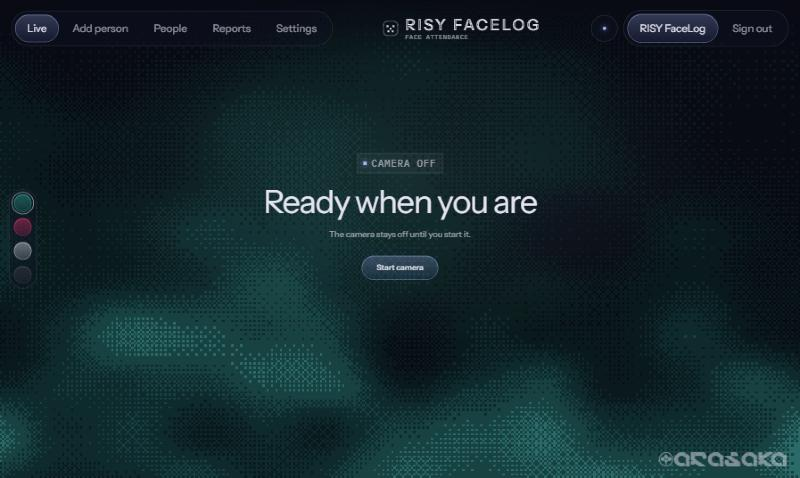
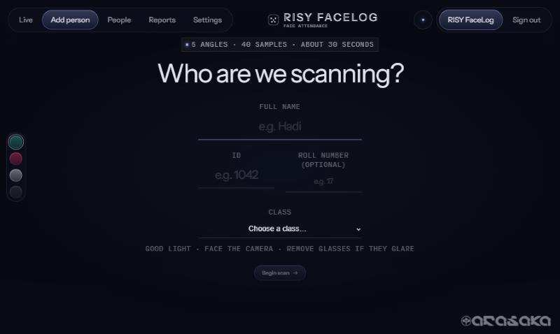
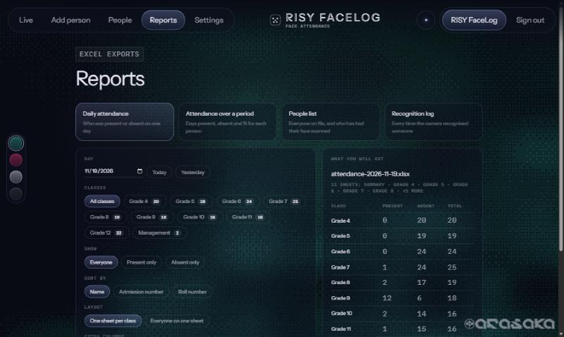
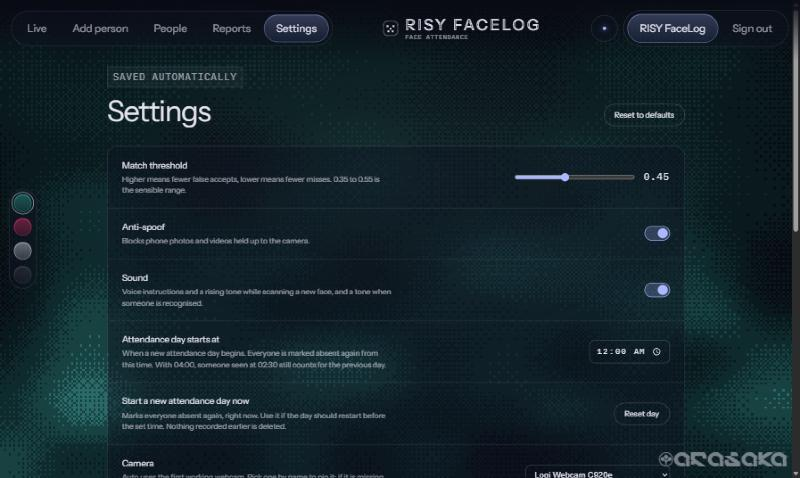

# RISY FaceLog

Real-time, GPU-accelerated face recognition built into an **attendance system**. People look at a camera and their attendance is logged automatically by face. A web interface handles enrolment, people, reports and settings.

Built by A Abdul Hadi. See [LICENSE](LICENSE): all rights reserved. The source code is not published in this repository.

---

## Table of contents

1. [Overview](#overview)
2. [Screenshots](#screenshots)
3. [Features](#features)
3. [How it works](#how-it-works)
4. [Anti-spoofing](#anti-spoofing)
5. [Enrolment](#enrolment)
6. [Attendance logic](#attendance-logic)
7. [Web interface](#web-interface)
8. [Reports](#reports)
9. [Security and privacy](#security-and-privacy)
10. [Architecture](#architecture)
11. [Tech stack](#tech-stack)
12. [Configuration](#configuration)
13. [Requirements](#requirements)
14. [Status and limitations](#status-and-limitations)
15. [Roadmap](#roadmap)
16. [Licence](#licence)

---

## Overview

Manual sign-in sheets and ID cards are slow, easy to fake and easy to lose. RISY FaceLog replaces them with a camera at the entrance: a person walks up, looks at the screen, and is marked present within a moment. Nothing to carry, nothing to swipe.

It is designed as a complete system, not just a model demo:

- a recognition engine that runs on the GPU in real time,
- an anti-spoofing layer so a photo or phone screen does not count as a person,
- a guided enrolment flow so people can be added without technical help,
- a database of attendance and a reporting page for managers,
- an admin login and an entrance-kiosk mode so the public camera screen cannot be used to change anything,
- encryption of the stored face data.

## Screenshots

Screenshots show the interface only. They contain no real people, names or face images.

**Live page.** The camera stays off until it is started.



**Add person.** Guided enrolment: name, ID, optional roll number and class, then 5 angles and 40 samples in about 30 seconds.



**Reports.** Excel exports with filters by day, class, present/absent, sort order and layout, plus a live preview of what the file will contain.



**Settings.** Match threshold, anti-spoof switch, sound, attendance-day start time, camera choice, and more. Changes save automatically.



## Features

**Recognition**
- Detects several faces at once, tracks them between frames and names each one.
- Votes over several frames before a name is shown, so a single lucky frame does not produce a wrong name.
- Handles faces that are too far away ("Move closer") or too close to the frame edge ("Move back").
- Detects a covered face (hand, mask) instead of guessing a name.

**Anti-spoofing**
- Two independent neural models plus a model-free 3-D head-movement test.
- Skips bad frames (blurry, moving, turned, badly lit) instead of failing people on them.
- Shows "Verifying" and asks for a slight head turn when unsure, rather than raising a false alarm.

**Enrolment**
- Guided capture from five head poses with live quality checks.
- Pauses automatically if another face is in view, and resumes afterwards.
- Spoken guidance during the scan.

**Management**
- People page with photos, per-person details and permanent erase.
- Roster import for adding many people at once.
- Reports: daily attendance, attendance over a period, people list, recognition log.
- Settings: recognition tuning, camera selection, and live camera picture controls.
- Admin sign-in, and a locked-down kiosk mode for the entrance screen.

## How it works

Every camera frame goes through this pipeline:

```
camera frame (BGR)
   |
   v
SCRFD-10G face detector  ->  face boxes + 5 landmarks
   |
   v
align / warp to 112 x 112
   |
   v
ArcFace R50  ->  512-dimensional embedding (L2-normalised)
   |
   v
cosine similarity against every enrolled person's templates
   |
   v
temporal voting  ->  name (or "unknown")
   |
   v
anti-spoof check must also say "live"  ->  attendance logged
```

Key design points:

- **Embeddings are L2-normalised**, so matching two faces is a single dot product. That keeps matching fast and is meant to scale to a large number of people.
- **Several templates per person.** Each person is stored from multiple poses and samples, and the best few matches are averaged. A bad template that does not resemble the rest of the person's profile is ignored.
- **A match must beat the runner-up** by a margin, so a lookalike does not get picked just because they scored slightly above the threshold.
- **Detection and tracking are split.** The detector runs every few frames; in between, face boxes follow optical flow. That is what keeps it smooth in real time while recognition and anti-spoofing run on top.
- **Frames are never mirrored before detection.** Only the on-screen preview is mirrored, so the models always see the true image.

## Anti-spoofing

A face-recognition attendance system is only useful if holding up someone's photo does not mark them present. Liveness is checked in layers:

1. **Two MiniFASNet models** judge whether the face crop looks like a real face or a photo/screen, each also scored on the mirrored crop. A face passes on the *lower* of the two scores, so a photo that fools one model but not the other is not averaged into a pass.
2. **A model-free 3-D test.** A flat photo's five facial landmarks always stay related by a single planar transform, however it is tilted. A real turning head breaks that. Detected real 3-D movement means the face is not flat.
3. **Quality gating.** A frame that is a poor picture of a face (moving too fast, blurry, head turned too far, too dark or washed out) is skipped, neither passing nor failing, so people are not wrongly blocked while walking in or under harsh light.
4. **Context check.** The models judge the face together with its surroundings (phone edge, paper edge, the hand holding it). If the face fills the frame, that context is cut off, so the system shows "Move back" instead of trusting the result.
5. **Conservative "spoof" verdict.** A face is only called a spoof when both models are low over a long window, enough frames have been watched, and no 3-D movement has been seen. Anything in between stays "Verifying" and no attendance is logged, but there is no false alarm.
6. **Re-checking and revocation.** After a face is accepted as live, it is still re-checked, so swapping a real face for a phone mid-session is caught.

## Enrolment

Adding a person takes about a minute and needs no technical knowledge:

1. An admin opens **Add person** and enters the person's full name, ID, an optional roll number and their class or group. People can also be brought in at once with **Import list**, then scanned later.
2. A spoken instruction asks everyone else to step out of view, then a countdown runs.
3. The person looks at the camera, then turns left, right, up and down. Several samples are taken at each of five poses.
4. Every sample passes quality gates: face size, sharpness, lighting (too dark, too bright, uneven side-light) and head angle.
5. Each sample must also resemble the earlier samples of the same scan, so a different person walking into view cannot be mixed in.
6. If another face appears, the scan pauses and resumes after they leave.
7. If someone is stuck on one head angle, a **Skip angle** option appears after a few seconds.

## Attendance logic

- A recognised, live face marks the person **present** for the current attendance day.
- Repeated sightings on the same day do not create duplicate attendance records.
- Every recognition is also written to a **recognition log** with the time, name, confidence and a face crop shown in the activity feed.
- Face crops in the activity feed are kept in memory only, not written to the database.
- An admin can reset the attendance day, after which people in view are marked again.
- Events and attendance are stored in a local SQLite database. If a write fails, the events stay queued and are retried, and the interface shows a warning.
- Erasing a person also removes them from the live feed and the pending write queue, so a queued event cannot bring their record back.

## Web interface

The interface is a React single-page app served by the same local server. Pages:

| Page | Purpose |
|---|---|
| **Home** | Landing page. |
| **Live** | Camera view with boxes, names and status (Verifying, Move closer, Move back, Face covered, Spoof blocked). Also used as the entrance kiosk screen. |
| **Add person** | Guided enrolment. |
| **People** | Everyone on file, grouped by class, with enrolled / still-to-scan counts, list import, scanning and permanent erase. |
| **Reports** | Attendance reports, with export. |
| **Settings** | Recognition tuning, camera choice, camera picture controls, anti-spoof toggle, admin password. |
| **Login** | Admin sign-in. |

Other interface features: keyboard shortcuts for the pages, selectable themes, spoken audio prompts, and a warning pill that appears if something needs attention (for example a failed database write).

## Reports

- **Daily attendance:** who was present or absent on a chosen day.
- **Attendance over a period:** days present, days absent and percentage for each person.
- **People list:** everyone on file and who has had their face scanned.
- **Recognition log:** every time the camera recognised someone.

Reports are exported as **Excel (.xlsx)** files. The Reports page lets you choose the day or period, which classes to include, everyone / present only / absent only, the sort order (name, admission number or roll number), and either one sheet per class or everyone on one sheet. A live preview shows what the file will contain before you download it.

## Security and privacy

Face data is biometric data, so the system is built around protecting it:

- **Encrypted at rest.** Face files are encrypted with AES-256-GCM. The key is stored separately from the data.
- **Admin login required.** Every management route needs an admin session. The built page itself loads without login only so the sign-in screen can appear.
- **Entrance kiosk mode.** The public camera screen runs with a limited kiosk token that can only view the Live page and switch the camera to recognition. It cannot enrol, edit, export or erase anything, and it cannot switch modes in the middle of an enrolment.
- **Kiosk control.** Admins can sign out every kiosk at once, for example if a kiosk PC is replaced or stolen. Changing the admin password signs out every other browser.
- **Same-origin protection.** A request guard rejects requests that come from another website.
- **Hardened responses.** The server sends a Content Security Policy and other security headers on every response, and the frontend loads only same-origin assets with no inline scripts.
- **Permanent erase.** Removing a person erases their stored faces, not just a database flag.
- **No biometric data in the repository.** `data/` and `models/` are never committed or shared.
- **Dependencies checked.** The frontend's production dependencies had no known vulnerabilities at the last audit.

Real-world use needs the consent of the people being enrolled and compliance with local biometric-data law. Face images should be stored and handled according to your organisation's policy.

## Architecture

```
 Webcam
   |
   v
+--------------------------------------------+
| Engine thread (one owner of camera + models)|
|  detect -> track -> embed -> match          |
|  anti-spoof -> activity log                 |
+--------------------------------------------+
   |                       |
   v                       v
 SQLite store        FastAPI server  <---->  React web UI
 (attendance,        (REST API, auth,        (Live, Add person,
  events, people)     kiosk, reports)         People, Reports, Settings)
```

- **One thread owns the camera and the models**, so there is no contention over the GPU or the device, and the camera is released shortly after the last viewer leaves.
- **The engine returns data, and the interfaces paint it.** Overlays are drawn by whichever front end is showing the video, so the same engine can drive the web app or a bare OpenCV window.
- **Tunable without a rebuild.** Recognition and camera settings can be changed in the Settings page and are saved, overriding the defaults.

## Tech stack

| Layer | Technology |
|---|---|
| Face detection | SCRFD-10G (ONNX) |
| Face recognition | ArcFace R50 (ONNX), 512-d embeddings |
| Anti-spoofing | MiniFASNet V2 and V1SE (ONNX) plus a geometric 3-D test |
| Inference | ONNX Runtime with CUDA (CPU fallback) |
| Vision | OpenCV, NumPy |
| Server | Python, FastAPI |
| Storage | SQLite |
| Encryption | AES-256-GCM |
| Frontend | React, Vite, TypeScript |
| Tested on | Windows 11, NVIDIA RTX 3050 (6 GB), Python 3.13 |

## Configuration

Everything tunable lives in one place and can also be changed from the Settings page. The main groups:

- **Camera:** camera choice (automatic or pinned), resolution and frame rate, and live picture controls such as brightness, contrast, saturation, sharpness, white balance, backlight and gain.
- **Detection:** detector size and confidence, how often the detector runs, and minimum face size.
- **Recognition:** match threshold and margin, voting window, and the confirmation rules for naming a new face.
- **Enrolment:** samples per pose, pose targets, and the quality gates.
- **Liveness:** thresholds for passing, the window sizes, quality gating, the 3-D test, and an on/off switch.

Raising the match threshold reduces false accepts; lowering it reduces misses.

## Requirements

- Windows 10/11 with a webcam (tested with Logitech C920e and Brio 100).
- An NVIDIA GPU is strongly recommended. Without one it falls back to the CPU, which is much slower, and the interface marks this.
- Python 3.13 and Node.js (to build the interface).
- The ONNX model files for detection, recognition and anti-spoofing, which are not included in this repository.

## Status and limitations

Working prototype, tested by the author against phone photos, phone video and prints, in different lighting, and with a larger employee database.

Known limitations:

- Anti-spoofing is a strong defence, not a guarantee. Very high-quality presentation attacks (for example 3-D masks) are beyond its scope.
- Shiny scalps, very dark skin and strong backlight are harder cases for liveness models, so the system is deliberately conservative about blocking and may ask for a head turn.
- Accuracy depends on camera quality and lighting at the entrance.
- Windows only, single machine, one camera at a time.

An optional extra second-opinion anti-spoof model exists but is **switched off**, because it is trained on a non-commercial dataset.

## Roadmap

- Encrypt stored face photos with the same scheme as the rest of the face data.
- Multi-camera and multi-site support.
- Role-based accounts (separate manager and admin roles).
- Pilot evaluation with measured false-accept and false-reject rates.
- Packaged installer.

## Licence

Copyright (c) 2026 A Abdul Hadi. All rights reserved. See [LICENSE](LICENSE).
